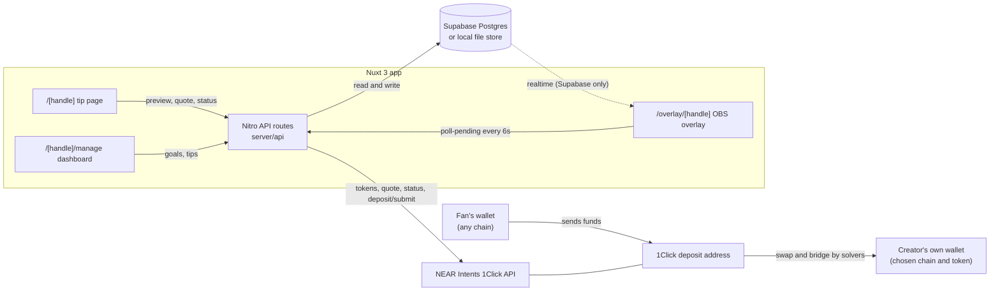

# Chetapawa

Chetapawa is a tip page for creators and streamers. Fans pay with a token they hold on any supported chain, and the NEAR Intents 1Click API swaps and bridges it into the one token the creator picked, paid straight to the creator's own wallet.

- Demo post on X: _(add link before submitting)_
- Live site: https://chetapawa.com (mock mode demo, see [Real mode status](#real-mode-status-read-this))
- Built from scratch during the NEAR HACKATHON, Nov 2026.

## The problem

A creator who wants tips in crypto has to pick one chain and one token. Fans hold something else on some other chain, so most of them give up. Existing tip jars that accept many chains usually hold the money in a custodial account first.

## What it does

1. A creator makes a page in about a minute: handle, payout address, and the token and chain they want to receive. No account, no email, no password.
2. A fan opens the page, picks any token on any chain, types an amount, and gets a one-time deposit address with a QR code.
3. The fan sends the funds from their own wallet. NEAR Intents swaps and bridges them and delivers the creator's chosen token to the creator's own address.
4. The tip page shows live status. The creator's OBS overlay plays an alert and moves the goal bar.

The app never holds funds. The quote's recipient is always the creator's own address, and refunds go to the fan's own address.

## Try it in 2 minutes (no keys, no accounts)

```bash
npm install
npm run dev
```

Open http://localhost:3000. With no `.env` file the app runs in **mock mode** with a **local data file**, and a yellow "MOCK mode" bar is shown on every page. Nothing real is sent or received.

| Do this | See this |
| --- | --- |
| Click **Create your tip page**, fill in a handle and display name, click **Use an example address**, then **Create my page** | Your tip page link and a one-time manage token |
| Tick "I saved my manage token", click **Go to dashboard** | The creator dashboard, with your token filled in |
| In the dashboard, add a goal (for example "New mic", $10) | The goal shows on the dashboard and on the tip page |
| Open the overlay link from the dashboard in a second tab | A transparent OBS overlay with the goal bar |
| Open the tip page, pick a token, tap **$5**, click **Use an example address**, then **Get deposit address** | A deposit address, QR code and countdown |
| Wait about 20 seconds | Status moves Waiting, then Processing, then Delivered. The overlay plays an alert and the goal bar fills |
| Send a tip whose amount ends in 13 (for example `2.13`) | The tip ends as Refunded, so you can see the failure screen |
| Open `/overlay/<handle>?demo=1` | Fake alerts in the browser only, labeled "Demo alerts" |

Mock data is saved in `.data/local-db.json`. Delete that file to start fresh.

## How NEAR is used

All payments go through the **NEAR Intents 1Click API** (`https://1click.chaindefuser.com`), called from `server/utils/intents.ts` with the official SDK `@defuse-protocol/one-click-sdk-typescript`.

| 1Click call | What we use it for |
| --- | --- |
| `GET /v0/tokens` | The list of tokens and chains fans can pay with and creators can receive. Prices for the $1, $2, $5 buttons. |
| `POST /v0/quote` with `dry: true` | The live "creator receives about X" estimate while the fan types. Also a one-time check that a new creator's payout address can be paid (real mode only). |
| `POST /v0/quote` with `dry: false` | Creates the one-time deposit address for a tip. `recipient` is the creator's own payout address, `refundTo` is the fan's own address. |
| `GET /v0/status` | Tracks each tip: waiting for deposit, processing, delivered, refunded or failed. Also gives the amount delivered and the transaction hashes. |
| `POST /v0/deposit/submit` | Optional "Already sent? Speed it up" box, which passes the fan's transaction hash to 1Click. |

NEAR Intents does the cross-chain work: it takes the deposit on the fan's chain, swaps and bridges through its solver network, and settles to the creator on the destination chain. We do not run a contract, a wallet or a bridge.

### Real mode status (read this)

Real mode is **wired but not verified with a funded swap.** Here is exactly what has been tested against the live 1Click API:

- Token list: works (229 tokens on 2026-11-11).
- Dry quotes: work for several routes (wNEAR, USDC on Base, SOL into USDC on NEAR), tested 2026-11-03 and 2026-11-11.
- One real (non-dry) quote that returned a deposit address, on 2026-11-03. It was never funded.
- No funded swap has been run, so delivery, the status updates from a real swap, and the goal update from a real tip have only been tested in mock mode.

## Tracks

- **Real-World Money.** Creator tipping is a real merchant-style payment flow. Fans pay in what they hold, creators receive a stablecoin (or any token) in their own wallet, with no custody and no sign-up. It uses NEAR Intents as the payment rail.
- **Open Innovation.** It uses chain abstraction for a consumer use case: the fan never has to know which chain the creator uses. The OBS overlay connects on-chain settlement to a live stream in real time.

## Architecture



- `server/utils/intents.ts`: every 1Click call, plus mock mode.
- `server/utils/supabase.ts`: picks Supabase when its keys are set, otherwise `server/utils/localDb.ts`.
- `supabase/schema.sql`: tables `cz_creators`, `cz_goals`, `cz_tips`, the `cz_goal_progress` view, row level security and realtime.

## How a tip flows

1. The fan opens `/<handle>`, picks a token and types an amount.
2. The page calls `POST /api/tips/preview`, which asks 1Click for a dry quote and shows what the creator receives.
3. The fan enters a refund address on their own chain and clicks **Get deposit address**.
4. `POST /api/tips/quote` asks 1Click for a real quote. Recipient: the creator's payout address. Refund: the fan's address. 1Click returns a one-time deposit address and a deadline. We save a `pending` tip.
5. The fan sends exactly that amount to the deposit address (QR code or copy).
6. The tip page polls `GET /api/tips/<id>/status` every 4 seconds. The server asks 1Click `GET /v0/status` and moves the tip forward: processing, then success, refunded or failed.
7. On success we store the delivered amount and its USD value, then mark the goal complete if it reached its target.
8. The overlay hears about it through Supabase realtime, or through `POST /api/poll-pending` every 6 seconds, which also settles tips after the fan closes their tab. It plays the alert and moves the goal bar.

## Goals

A creator has at most one active goal: a title and a target in US dollars. Progress is the sum of the USD value of delivered tips tied to that goal. Goals are display only. There is no custody, no escrow and no refunds when a goal is missed: tips already went to the creator's wallet.

## Run locally

Requires Node 20 or later.

```bash
npm install
npm run dev          # mock mode + local data file, no keys needed
```

Real mode, still with the local data file:

```bash
MOCK_INTENTS=false npm run dev
```

In real mode deposit addresses are real. Only send small amounts you can afford to lose. There is no Intents testnet.

With Supabase (needed for a deployed site and for realtime):

1. Create a Supabase project and run `supabase/schema.sql` in its SQL editor.
2. Copy `.env.example` to `.env` and fill in the three Supabase values.
3. `npm run dev`.

Production build: `npm run build`, then `node .output/server/index.mjs`. With `MOCK_INTENTS` blank, a production build uses **real mode**.

## Mock mode

Mock mode fakes only the 1Click API. Everything else (database, goals, overlay, rate limits) runs as normal.

- Turned on by `MOCK_INTENTS=true`, or by leaving it blank in development. Turned off by `MOCK_INTENTS=false`.
- In production it also needs `MOCK_INTENTS_ALLOW_PRODUCTION=true`, so a stray flag cannot fake payments on a live site.
- 13 fake tokens with fixed prices. Fake deposit addresses start with `mock_`.
- Status moves pending, then processing, then success over about 20 seconds. Amounts ending in `13` end as refunded.
- Every page shows a yellow "MOCK mode" bar, and the overlay shows a corner pill. The server logs a loud banner on start.

## Environment variables

All optional. See `.env.example`.

| Variable | Purpose |
| --- | --- |
| `NUXT_PUBLIC_SUPABASE_URL` | Supabase project URL. Blank: local data file. |
| `NUXT_PUBLIC_SUPABASE_ANON_KEY` | Public anon key, used by the browser for realtime only. |
| `SUPABASE_SERVICE_ROLE_KEY` | Server-only key for writes. Never sent to the browser. |
| `ONE_CLICK_API_BASE` | Defaults to `https://1click.chaindefuser.com`. |
| `ONE_CLICK_JWT` | Optional partner JWT from https://partners.near-intents.org. Without it, 1Click adds a small fee to each quote. |
| `MOCK_INTENTS` | `true`, `false`, or blank (mock in development, real in production). |
| `MOCK_INTENTS_ALLOW_PRODUCTION` | Must be `true` to allow mock mode when `NODE_ENV=production`. |
| `NUXT_PUBLIC_SITE_URL` | Used to build the share links. Defaults to `http://localhost:3000`. |

## Deploy

The app is a standard Nuxt 3 server app. `netlify.toml` holds the Netlify build settings (build command, `dist` folder, Node 22). Other hosts like Vercel detect Nuxt without extra config. Set the Supabase variables and `NUXT_PUBLIC_SITE_URL` in the host's settings. Serverless hosts do not keep local files, so a deployed site needs Supabase. The local data file is for local runs.

## Libraries and tools used

- Nuxt 3, Vue 3, Vue Router, TypeScript.
- `@defuse-protocol/one-click-sdk-typescript`: official NEAR Intents 1Click SDK.
- `@supabase/supabase-js`: database and realtime (optional).
- `zod`: input validation on every API route.
- `qrcode`: deposit address QR codes.
- Sora font from Google Fonts.
- AI assistance: the code and docs were written with Claude Code (Anthropic), directed and reviewed by the author.

No code was taken from any earlier project. The first commit is dated 2026-11-02, inside the hackathon window.

## Decisions

- Without Supabase keys the server uses `server/utils/localDb.ts`, an in-memory store saved to `.data/local-db.json`. It implements only the query builder methods this app calls (select, insert, update, eq, in, gte, is, order, limit, single, maybeSingle) and copies the database rules that matter: unique handles, one active goal per creator (same `23505` error code), column defaults, and the goal progress view. The API routes run unchanged on either backend. Realtime is off in this mode and the overlay polls instead.
- `MOCK_INTENTS` blank means mock in development and real in production. A clean clone runs with no keys, and a production deploy never fakes payments by accident.
- In real mode, creating a page runs one dry quote that pays the new payout address. 1Click rejects recipients it cannot pay (for example a NEAR account that does not exist) with a bare 400, which used to make every tip on that page fail. Only a 400 blocks creation. Network errors do not.
- In mock mode, the create and tip forms offer "Use an example address", filled from well-known burn addresses that pass the address check. The button is never shown in real mode.
- Database tables use a `cz_` prefix: `cz_creators`, `cz_goals`, `cz_tips`.
- Built on Nuxt 3 (3.21.x) as the brief requires, even though Nuxt 4 is the current major version.
- Server secrets (`SUPABASE_SERVICE_ROLE_KEY`, `ONE_CLICK_JWT`) are read from `process.env` at runtime in `server/utils/env.ts`, not through `nuxt.config.ts`, so they are never baked into build output. Verified with a canary value and a grep of `.output`.
- `cz_creators.manage_token_hash` is hidden from the browser with column-level grants, not a view. Browser code must select named columns from `cz_creators`. `select *` is denied for the anon role.
- One active goal per creator is enforced in the database with a partial unique index.
- `cz_goal_progress` is a `security_invoker` view (needs Postgres 15+, which Supabase uses). It returns `raised_usd` (sum of `amount_out_usd`) and `raised_out` (sum of `amount_out` in the receive asset's raw units) for successful tips, so the app can pick either for goal math.
- `cz_tips.goal_id` uses `on delete set null`, so deleting a goal keeps its tip history.
- All 1Click calls live in `server/utils/intents.ts`, built on the official SDK `@defuse-protocol/one-click-sdk-typescript`. Field names were taken from the OpenAPI spec and checked against the live API (dry quotes and one unfunded real quote) on 2026-11-03.
- Swaps use `EXACT_INPUT`, `depositType: ORIGIN_CHAIN`, `recipientType: DESTINATION_CHAIN` and 1% slippage. The recipient is always the creator's own payout address.
- Refunds: 1Click requires `refundTo` and checks it against the refund chain's address format. Real quotes refund to the fan's own address on the chain they pay from (`refundType: ORIGIN_CHAIN`), so the tip form asks the fan for it. Dry previews run before the fan has typed anything, so they use a placeholder NEAR Intents account. A dry quote creates no deposit address, so nothing can ever be sent there.
- Stellar requires `depositMode: MEMO` (confirmed on the live API). Other chains use `SIMPLE`. If 1Click rejects the deposit mode for any other chain, the wrapper retries once with the other mode.
- We request a 30 minute deadline (2 hours for slow chains like BTC). 1Click may return a later one, and the deadline it returns is the one shown to fans.
- Status mapping: `PENDING_DEPOSIT` and `INCOMPLETE_DEPOSIT` become `pending`; `KNOWN_DEPOSIT_TX` and `PROCESSING` become `processing`; `SUCCESS`, `REFUNDED` and `FAILED` map to `success`, `refunded` and `failed`. `expired` is our own status for an unfunded quote past its deadline.
- `ONE_CLICK_JWT` is optional. Without it, 1Click adds a small fee to every quote (the 1Click docs we read on 2026-11-03 said 0.25%, the hackathon FAQ says 0.2%). The SDK sends it as a Bearer token, which the docs accept.
- 1Click's error messages are rewritten for fans. For example, minimum amounts are shown in token units instead of base units.
- Mock mode is on with `MOCK_INTENTS=true` or a blank value in development. When `NODE_ENV=production`, `MOCK_INTENTS=true` also needs `MOCK_INTENTS_ALLOW_PRODUCTION=true`, otherwise it is ignored with a logged error. When active, the server logs a loud banner and every page shows a yellow "MOCK" bar.
- Mock status moves pending, then processing, then success over about 20 seconds. Mock tips whose amount ends in "13" (like 2.13) end as `refunded`, so the failure UI can be tested.
- Creator handles: 3 to 24 characters `a-z 0-9 _`, a leading `@` is stripped, and route words like `create`, `overlay` and `api` are reserved.
- Payout address checks are length and character-class only, per chain (NEAR account, EVM `0x` + 40 hex, Solana base58, BTC, Tron, Stellar, XRP, TON and so on). They catch addresses pasted from the wrong chain but do not verify checksums. The UI warns clearly that the address must be on the chosen chain.
- The server never trusts the token symbol or chain sent by the browser. It looks up `destAssetId` in the 1Click token list and stores the symbol and chain from there.
- Manage tokens are `cgt_` plus 32 random bytes (base64url). Only the sha256 hash is stored, and checks use a constant-time compare. After creation the raw token is also saved in the creator's own browser `localStorage` so the dashboard can fill it in, but the creator must still confirm they saved it before continuing.
- Creating a page is rate limited to 5 per IP per 10 minutes, in memory. The IP comes from `x-forwarded-for`, which the hosting platform sets. The limiter resets on server restarts, which is acceptable for a demo.
- In mock mode a full-width yellow strip sits above the header on every page, so it never covers content. The OBS overlay uses a small corner pill instead.
- Coral (`#FF6B4A`) is used for fills with charcoal text. Primary text buttons use rust (`#B44226`) with white text so they pass WCAG AA contrast.
- `cz_tips` has four columns beyond the brief's data model: `amount_in_formatted` and `amount_out_formatted` (human units, so the overlay and dashboard never need token decimals), `quote_out_usd` (the quote's USD estimate) and `expires_at` (the deposit deadline 1Click returns). `schema.sql` adds them with `add column if not exists`, so re-running it upgrades older databases.
- Goal math: progress is the sum of `amount_out_usd` over successful tips tied to the goal. `amount_out_usd` comes from 1Click's status response. If 1Click does not report it, we store the quote's USD estimate instead, as the brief allows. When a success pushes a goal past its target, `completed_at` is stamped once so the overlay celebrates once.
- A tip is tied to the creator's goal that was active when the fan requested the deposit address.
- Tip statuses only move forward (pending, then processing, then a final state). Updates are conditional on the previous status, so two pollers can never overwrite each other. Each tip's live 1Click check is reused for 3 seconds.
- `expired` is set when a tip is still waiting for its deposit after the 1Click deadline. Expired tips are still re-checked for 48 hours, so a late deposit shows up as refunded (or processed) instead of disappearing.
- The fan's refund address is sent to 1Click but never stored in our database.
- The tip page remembers the fan's open tip in `localStorage` (`cgt_tip_<handle>`), so a reload never loses the deposit address. "Start a new tip" clears it.
- The receive estimate uses a dry quote, debounced by 600 ms. Quick-amount buttons ($1, $2, $5) use the token list's USD price and round to 3 significant figures.
- The QR code holds only the deposit address, which every wallet can scan. Amount and memo are shown with their own copy buttons. Memo chains (Stellar) show a red "memo required" warning.
- The optional "Already sent? Speed it up" box forwards a transaction hash to 1Click's `POST /v0/deposit/submit`.
- Rate limits per IP: previews 60 per minute, deposit addresses 10 per 10 minutes (and 60 per 10 minutes per creator), status checks 120 per minute, tx hash submits 10 per 10 minutes.
- Name and message are trimmed, control characters removed, and capped at 40 and 140 characters. They are rendered as text, never as HTML.
- Creator write routes take the raw manage token in the `x-manage-token` header. `POST /api/goals` names the creator by `handle`. `PATCH /api/goals/[id]` checks the token against the goal's owner, so one creator's token can never change another creator's goal.
- After 10 bad manage tokens from one IP in 10 minutes, that IP gets 429 for the rest of the window. Correct tokens are not counted. Tokens are 256 random bits, so this is about noise, not guessing.
- The dashboard reads its data from `GET /api/creators/[handle]/dashboard` (manage token required) rather than straight from Supabase, so the page never needs extra database permissions.
- Starting a goal ends the previous active one first. If two requests race, the unique index rejects one insert and the route retries once.
- Goal targets are US dollars, $1 to $1,000,000, rounded to cents. Ended goals cannot be edited; start a new one instead.
- Editing a target can complete a goal (new target at or below what is raised) or reopen a completed one (new target above what is raised), so the bar always matches the numbers.
- "End goal" uses an inline "Yes, end it" confirmation instead of a browser dialog.
- The dashboard refreshes every 8 seconds while the tab is visible, and pauses while the goal form is open. A saved goal shows immediately, and a refresh that started before a save is ignored, so stale data never overwrites a change.
- "Remember on this device" keeps the manage token in `localStorage` under `cgt_manage_<handle>`. "Lock" removes it. A stored token that stops working is removed automatically.
- While a tip is processing, "Send another tip" is disabled so the fan cannot lose the status tracker mid-swap. While waiting for the deposit, "Cancel and start over" asks for confirmation first, in case funds are already on the way.
- `POST /api/poll-pending` re-checks a creator's `pending` and `processing` tips (max 20, under 48 hours old) with up to 5 calls to 1Click at a time. The per-handle limit is a throttle, not an error: 1Click is asked at most once per creator every 5 seconds, however many overlays and dashboards are open. Calls inside that window still return the goal and delivered tips. There is also a per-IP limit of 60 calls a minute.
- The overlay gets tips two ways and drops duplicates by tip id: Supabase realtime (instant) and `poll-pending` every 6 seconds (which also settles tips after the fan closes their tab). Without the public Supabase keys it still works through polling alone.
- `poll-pending` takes a `since` time and returns tips delivered after it. The overlay sends its last server time minus 30 seconds, so a write that lands late is still picked up. Tips delivered before the overlay opened never replay.
- Overlay alerts play one at a time from a queue. A goal celebration jumps ahead of queued tips, so it plays right after the tip that reached the goal. When more than 3 alerts are waiting, each one is shown for less time. The queue holds at most 30 tips and drops the oldest first.
- The goal celebration plays once per goal. Celebrated goal ids are kept in the overlay's `localStorage`. On load, a goal that was reached in the last 2 minutes is still celebrated, in case OBS reloaded at that moment. Goals reached earlier just show a full bar.
- Overlay sounds are made with Web Audio, so no audio files ship. Sound is on by default and `?sound=0` turns it off. OBS plays audio without a click. A normal browser tab may need one click first.
- `?demo=1` runs entirely in the browser. It makes no payments and writes nothing to the database. It uses the creator's real goal title and target when there is one. Fake tips are sized to the target, so the goal fills over several alerts, celebrates, then starts over. A small "Demo alerts" label stays visible so a recording cannot pass for real tips.
- Overlay query params: `?compact=1`, `?sound=0|1`, `?scale=` (0.5 to 3) and `?demo=1`. They can be combined.

## Known limitations

- **No funded real swap yet.** See "Real mode status" above.
- **No testnet.** NEAR Intents has no testnet, so real mode uses mainnet. Use small amounts.
- **Minimum swap sizes.** 1Click rejects amounts that are too small for a route. The tip page shows the minimum in token units when that happens.
- **Goal USD value.** Goal progress uses the USD value 1Click reports at delivery. If 1Click does not report it, we use the quote's USD estimate. Token prices move, so the bar is an estimate, not accounting.
- **Deposit addresses expire.** A deposit address is valid until the deadline 1Click returns (we ask for 30 minutes, 2 hours for slow chains like BTC). Funds sent after that are refunded by 1Click to the fan's refund address.
- **Address checks are format only.** We check length and characters per chain, not checksums. In real mode the dry quote check catches recipients 1Click cannot pay.
- **Rate limits are in memory.** They reset when the server restarts.
- **Manage token is the only login.** If a creator loses it, nobody can recover it.

## What's next

None of this is built yet. It is the plan for turning Chetapawa into a product after the hackathon.

**Business model.** 1Click quotes accept an app fee (`appFees`), which 1Click pays to a chosen account when the swap settles. A small fee per tip (for example 1%) would fund the product without Chetapawa ever holding the tip itself.

**Product**

- Bank payout through a licensed off-ramp partner, so creators can receive local currency.
- A wallet-connect pay button, so fans do not copy an address by hand.
- Recurring tips (monthly support).
- Several goals at once, and goal pages that can be shared on their own.
- More overlay styles and an alert sound picker.

**Creators to reach first.** Streamers and creators whose fans are spread across many countries and chains, where a single-chain tip jar loses most fans.

## License

MIT. See `LICENSE`.
